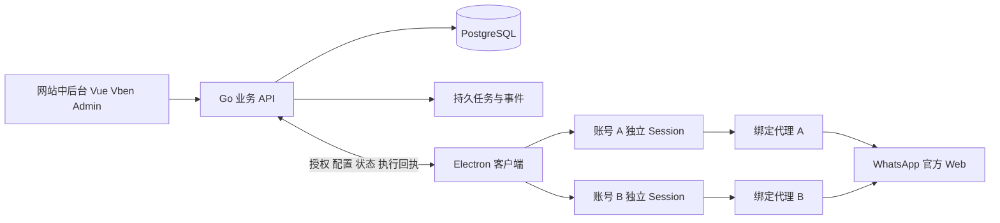

# gongdan007 架构与接口设计

网站拥有业务规则和授权状态，客户端拥有平台浏览器会话。平台网页在使用者电脑中直接与平台服务通信，管理网站通过独立连接接收必要元数据与经过授权的业务事件。

## 系统关系



网站 API 的连接和平台代理连接分别配置。登录码、设备令牌不发送给平台网页或平台代理供应商的接口。业务权限撤销控制本系统访问及客户端行为，不等同于从 WhatsApp 手机端撤销已关联设备；平台注销操作须独立确认执行结果。

## 仓库目录与依赖方向

```text
gongdan007/
  apps/
    admin/src/modules/              网站业务页面，使用 Element Plus 版 Vben
    desktop/src/
      main/                        窗口 会话 代理 设备授权 同步 更新
      preload/                     受限桥接，仅提供白名单能力
      renderer/                    登录码 账号切换 外围状态界面
  server/
    cmd/api/                       装配与启动
    internal/
      foundation/                  配置 数据库 日志 认证 租户上下文
      modules/
        identity/                  网站身份与租户角色
        logincodes/                登录码 使用者席位 授权模板
        devices/                   设备会话 名额 租约 撤销
        accounts/                  平台账号 归属 状态与指令
        proxies/                   代理资产 分组 分配 检测
        baseline/                  底库 导入 查重范围
        leads/                     线索 来源 分享 分配
        customers/                 客户 标签 跟进
        archive/                   会话 消息 索引与同步进度
        controls/                  规则 告警 处理记录
        billing/                   套餐 订单 账本 计量
        promotion/                 推广 归因 佣金 提现
        audit/                     登录记录 操作审计
    migrations/                    顺序化数据库迁移
  packages/
    platform/core/                 平台适配契约及能力定义
    platform/whatsapp/             WhatsApp 官方网页适配
    api-client/                    从 OpenAPI 生成的前端客户端
    ui-tokens/                     网站与客户端外围样式变量
  contracts/                       OpenAPI 事件 模块与状态定义
  infra/                           反向代理 服务 部署与恢复
  scripts/                         开发 检查 打包 发布脚本
  docs/                            计划 决策 验收
```

每个业务模块包含 HTTP 处理、业务服务、数据访问、模型、输入校验和相关测试。HTTP 层不直接修改其他模块的数据表；业务服务显式声明跨模块依赖。复杂跨模块事务由单独的用例服务协调。认证、租户上下文和数据库是公共基础设施，不放进页面组件。

适配包只依赖平台核心契约，不依赖网站菜单或财务模块。平台应用标识 `platform_key` 为稳定字符串，新增平台不修改公共表结构。HTTP 契约生成前端类型，数据库对象不直接作为对外返回结构。

## 身份与数据归属

业务链为 `tenant → seat → login_code → device_session → platform_account_binding`。同一租户可有多个网站用户、席位和设备。推广关系独立使用 `referral_code`，不复用 `login_code`。

账号实体与本地运行绑定分开：`platform_account` 保存平台身份，`account_binding` 保存席位、设备、本地配置 ID 和运行归属。同一身份在多个设备出现时保留各自绑定，不按名称创建互不关联的重复客户，也不直接覆盖另一使用者的归属。

账号首次未登录时是客户端建立的本机浏览器环境；检测到可信平台身份后才绑定正式身份。重置登录码不改变席位 ID，本机浏览器目录通过稳定绑定 ID 查找。转移使用者、换电脑或跨租户不复制平台 Cookie，使用明确的重新关联流程。

| 领域 | 主要表 |
| --- | --- |
| 身份 | tenants、admin_users、memberships、roles、permissions、role_permissions、seats |
| 登录码 | login_codes、login_code_groups、login_code_policy_versions、device_registrations、device_sessions |
| 平台 | platform_accounts、account_bindings、account_slots、account_state_events、device_commands |
| 代理 | proxies、proxy_groups、proxy_bindings、proxy_checks |
| 底库 | contact_baselines、contact_identities、import_batches、import_rows、dedup_policies |
| 线索客户 | leads、lead_sources、lead_assignments、customers、customer_identities、tags、customer_tags、followups |
| 归档 | conversations、messages、sync_checkpoints、event_inbox、event_outbox |
| 内控 | control_rules、control_alerts、alert_actions |
| 账户 | plans、subscriptions、orders、wallet_accounts、ledger_transactions、ledger_entries、usage_events |
| 推广 | referral_codes、referrals、commission_entries、withdrawal_requests |
| 审计 | login_events、audit_events、export_jobs |

所有租户业务表携带 `tenant_id`，唯一约束、外键关系和查询范围一并约束租户。控制台跨租户统计只允许运营角色；客户端上报只能写入当前设备被授权的账号绑定。客户级去重和平台级去重的键明确区分，不使用联系人姓名作为唯一键。

## 登录码鉴权与设备租约

登录码采用足够随机的可输入编码，格式包含用于检索的公开编号与随机秘密部分。后端只保存验证所需的摘要和密钥版本，日志、URL、埋点不记录完整码。验证接口限速，错误返回不泄露某个编号是否存在。

设备注册使用本机生成的密钥对与安装实例 ID。验证登录码后，在事务中检查有效期、设备上限和策略版本，再建立设备会话。并发请求通过唯一约束及锁保持名额正确。客户端首次激活将设备凭据存入系统安全存储，后续通过设备会话和刷新凭据取得短期访问权。

访问令牌、刷新凭据和设备租约各自有用途。刷新凭据轮换并能由服务器撤销；本机受理过的租约有到期时间，进程运行中使用单调时钟判断剩余时长，重启需要向服务器重新验证。旧策略或重复上报不能恢复已撤销会话。

初始试运行建议值：心跳 30 秒、后台失联判定 90 秒、授权租约 5 分钟。停用通过推送与轮询共同下发；客户端失去服务端连接后，界面展示剩余授权时间，到期暂停官方网页。对篡改客户端的本机管理员不提供绝对防绕过保证；所有网站接口始终在服务端执行权限限制。

## 平台适配契约

```ts
type Capability =
  | 'identity' | 'connectionState' | 'contacts'
  | 'liveMessages' | 'history' | 'media' | 'logout';

interface PlatformAdapter {
  key: string;
  version: string;
  entryUrl: string;
  allowedOrigins: readonly string[];
  capabilities: Partial<Record<Capability, 'supported' | 'experimental'>>;
  attach(context: AccountPageContext): Promise<Detach>;
  inspectIdentity(context: AccountPageContext): Promise<IdentityResult>;
  inspectState(context: AccountPageContext): Promise<StateObservation>;
}
```

这是计划中的契约示意，最终类型在平台核心包定义。`AccountPageContext` 由主进程注入受限能力；适配器不直接访问平台之外的会话、代理密码、设备令牌或文件系统。`IdentityResult` 允许明确的不可用结果。

官方页面自己的二维码与收发消息流程保持原样。基本浏览能力与数据采集能力分别开关；平台网站升级造成采集异常时，记录版本与诊断后降级为仅原生页面运行。

## 浏览器会话与网络

账号分区键使用 `persist:<tenant-id>:<binding-id>` 或等价稳定 ID，由主进程构造。页面初始化前设置对应 Session 代理，再导航；代理凭据只在对应会话的代理认证场景提供。代理更新先关闭旧连接、重新校验，再恢复导航。

远程页面设置 Node 集成关闭、上下文隔离开启、沙箱开启、Web 安全开启；受限 preload 使用最小 IPC 白名单，主进程校验请求来源和所属账号。拒绝任意协议、任意新窗口和未知权限；允许的平台登录弹窗保持同账号会话。正常外链按策略交给系统浏览器。[Electron 安全指南](https://www.electronjs.org/docs/latest/tutorial/security)

代理方案必须实际覆盖 WebSocket、页面、媒体、Service Worker 及允许的 WebRTC 行为。独立 Session 是应用级隔离，若业务需要进程外强制隔离，要通过分开的浏览器进程与系统网络策略实现并独立验收。对代理不可用、认证失败、绕过规则、IPv6 与 DNS 路径分别测试。

代理检测优先在客户端对指定平台目标执行。服务器检测固定目标与端口，对可提交的检测地址做限制；后台显示检测来源与时间，避免把服务器网络检测误当成使用者电脑连通性。

## 接口与事件分组

| 前缀或事件 | 用途 |
| --- | --- |
| `/api/v1/auth/*` | 网站登录、退出、当前身份 |
| `/api/v1/login-codes/*` | 登录码、策略、批量操作、重置 |
| `/api/v1/devices/*` | 授权设备、解绑、撤销、操作回执 |
| `/api/v1/platform-accounts` | 管理员查看客户端同步账号，无后台创建接口 |
| `/api/v1/client/account-options` | 当前登录码额度、可用平台与本团队启用代理的摘要（无代理密码） |
| `/api/v1/client/accounts` | 客户端查看 / 添加账号，归属取会话身份，创建请求键保证重试不重复 |
| `/api/v1/proxies/*` | 代理资产、导入、检测与分配 |
| `/api/v1/baselines/*` | 底库、导入批次、去重策略 |
| `/api/v1/leads/*` | 线索、分配、分享、导出 |
| `/api/v1/customers/*` | 客户、标签、跟进、会话查询 |
| `/api/v1/controls/*` | 规则、告警、处理 |
| `/api/v1/billing/*` | 套餐、订单、充值、账本、计量 |
| `/api/v1/promotion/*` | 推广、归因、佣金、提现审核 |
| `/api/v1/audit/*` | 登录日志与审计查询 |
| `/api/v1/client/auth/*` | 登录码校验、设备会话刷新与退出 |
| `/api/v1/client/events` | 元数据、状态与可用业务事件上报 |
| `/api/v1/client/commands/*` | 指令领取、结果回执与状态查询 |
| `account.state.changed` | 平台状态变化和观察时间 |
| `device.session.revoked` | 设备授权撤销 |
| `proxy.assignment.changed` | 代理配置版本更新 |
| `message.observed` | 有采集能力的平台消息事件 |
| `billing.payment.confirmed` | 入账完成后驱动佣金处理 |

HTTP 使用统一错误码、请求 ID、分页结构和服务端时间。敏感操作、导入、充值与上报带幂等键。代理更新、账号注销和设备撤销返回“已下发”，客户端确认后才显示“已执行”；离线时保留排队或失败状态。

事件包含 `schema_version`、`event_id`、设备和绑定 ID、来源观察时间、服务端接收时间及适配器版本。服务端使用会话推导租户，不信任客户端任意提交的租户字段。相同事件重放不重复写入业务数据，旧状态事件不能覆盖较新状态。

## 钱包与推广数据一致性

钱使用最小货币单位整数或固定精度十进制，禁止浮点计算。订单结算、余额变更与账本写入在同一事务完成；支付通知按通道流水号唯一约束，佣金按来源入账事件唯一约束。退款使用反向流水，保留原记录。

充值先支持运营审核入账与完整审计，自动支付对接通过同一结算入口。提现申请、审核、支付和失败分别记录，正式出款方式按所选支付通道接入；测试环境使用模拟回调，不产生真实付款。

## 发布与数据边界

中后台静态包、Go 二进制、客户端安装包各有版本号，共享接口兼容版本。客户端心跳报告自身版本和适配器版本，服务端拒绝不兼容的写入并给出升级提示。首次数据库迁移与后续升级均记录版本，不依赖生产启动时任意自动改表。

安装包按操作系统分别构建，正式发布验证签名、安装、升级和卸载；浏览器运行数据与程序安装目录分开。浏览器目录不进入 Git 或普通上传接口，业务附件和数据库采用独立备份策略。
