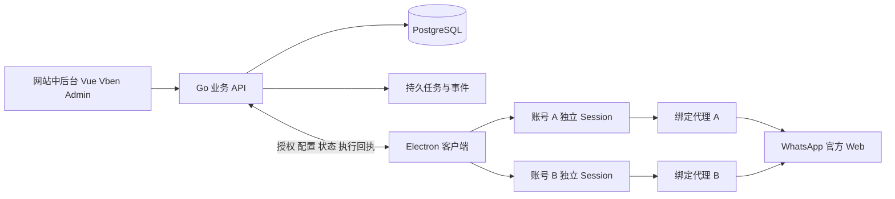

# gongdan007 架构与接口设计

网站拥有业务规则和授权状态，客户端拥有平台浏览器会话。平台网页在使用者电脑中直接与平台服务通信，管理网站通过独立连接接收必要元数据与经过授权的业务事件。

## 系统关系



网站 API 的连接和平台代理连接分别配置。登录码、设备令牌不发送给平台网页或平台代理供应商的接口。业务权限撤销控制本系统访问及客户端行为，不等同于从 WhatsApp 手机端撤销已关联设备；平台注销操作须独立确认执行结果。

## 仓库目录与依赖方向

```text
gongdan007/
  apps/
    admin/src/modules/              网站业务页面，使用 Element Plus 版 Vben
    desktop/src/
      main/                        窗口 会话 代理 设备授权 同步 更新
      preload/                     受限桥接，仅提供白名单能力
      renderer/                    登录码 账号切换 外围状态界面
  server/
    cmd/api/                       装配与启动
    internal/
      foundation/                  配置 数据库 日志 认证 租户上下文
      modules/
        identity/                  网站身份与租户角色
        logincodes/                登录码 使用者席位 授权模板
        devices/                   设备会话 心跳 撤销
        accounts/                  平台账号 归属 状态与指令
        proxies/                   代理资产 分组 分配 检测
        baseline/                  底库 导入 查重范围
        leads/                     线索 来源 分享 分配
        customers/                 客户 标签 跟进
        archive/                   会话 消息 索引与同步进度
        controls/                  规则 告警 处理记录
        billing/                   套餐 订单 账本 计量
        promotion/                 推广 归因 佣金 提现
        audit/                     登录记录 操作审计
    migrations/                    顺序化数据库迁移
  packages/
    platform/core/                 平台适配契约及能力定义
    platform/whatsapp/             WhatsApp 官方网页适配
    api-client/                    从 OpenAPI 生成的前端客户端
    ui-tokens/                     网站与客户端外围样式变量
  contracts/                       OpenAPI 事件 模块与状态定义
  infra/                           反向代理 服务 部署与恢复
  scripts/                         开发 检查 打包 发布脚本
  docs/                            计划 决策 验收
```

每个业务模块包含 HTTP 处理、业务服务、数据访问、模型、输入校验和相关测试。HTTP 层不直接修改其他模块的数据表；业务服务显式声明跨模块依赖。复杂跨模块事务由单独的用例服务协调。认证、租户上下文和数据库是公共基础设施，不放进页面组件。

适配包只依赖平台核心契约，不依赖网站菜单或财务模块。平台应用标识 `platform_key` 为稳定字符串，新增平台不修改公共表结构。HTTP 契约生成前端类型，数据库对象不直接作为对外返回结构。

## 身份与数据归属

业务链为 `tenant → seat → login_code → device_session → platform_account_binding`。同一租户可有多个网站用户、席位和设备。推广关系独立使用 `referral_code`，不复用 `login_code`。

账号实体与本地运行绑定分开：`platform_account` 保存平台身份，`account_binding` 保存席位、设备、本地配置 ID 和运行归属。同一身份在多个设备出现时保留各自绑定，不按名称创建互不关联的重复客户，也不直接覆盖另一使用者的归属。

账号首次未登录时是客户端建立的本机浏览器环境；检测到可信平台身份后才绑定正式身份。重置登录码不改变席位 ID，本机浏览器目录通过稳定绑定 ID 查找。转移使用者、换电脑或跨租户不复制平台 Cookie，使用明确的重新关联流程。

| 领域 | 主要表 |
| --- | --- |
| 身份 | tenants、admin_users、memberships、roles、permissions、role_permissions、seats |
| 登录码 | login_codes、login_code_groups、login_code_policy_versions、device_registrations、device_sessions |
| 平台 | platform_accounts、account_bindings、account_slots、account_state_events、device_commands |
| 代理 | proxies、proxy_groups、proxy_bindings、proxy_checks |
| 底库 | contact_baselines、contact_identities、import_batches、import_rows、dedup_policies |
| 线索客户 | leads、lead_sources、lead_assignments、customers、customer_identities、tags、customer_tags、followups |
| 归档 | conversations、messages、sync_checkpoints、event_inbox、event_outbox |
| 内控 | control_rules、control_alerts、alert_actions |
| 账户 | plans、subscriptions、orders、wallet_accounts、ledger_transactions、ledger_entries、usage_events |
| 推广 | referral_codes、referrals、commission_entries、withdrawal_requests |
| 审计 | login_events、audit_events、export_jobs |

所有租户业务表携带 `tenant_id`，唯一约束、外键关系和查询范围一并约束租户。控制台跨租户统计只允许运营角色；客户端上报只能写入当前设备被授权的账号绑定。客户级去重和平台级去重的键明确区分，不使用联系人姓名作为唯一键。

## 登录码鉴权与持久设备会话

登录码和设备会话令牌均采用高熵随机值，以摘要校验。为支持重复复制，登录码另用现有服务主密钥进行 AES-GCM 加密保存；设备令牌仍只保存摘要，日志不记录完整凭证。当前客户端使用本机生成的安装实例 ID，验证登录码后在事务内检查有效期、启停、删除状态和平台权限，不限制登录码的设备数或账号数。同设备重登替换旧令牌。

客户端用 Electron safeStorage 加密保存设备令牌、服务地址、账号列表、平台列表和上次选中的账号；文件先写临时副本后原子替换。退出与写入串行，避免旧异步写入恢复已退出会话。原始登录码不持久保存。设备会话无独立固定期限，登录码有效期、启停状态及设备授权仍由服务端逐次校验；管理员撤销或用户主动退出可以使令牌失效。

每 30 秒同步心跳和账号权限，唤醒与网络恢复后主动重试。超时、5xx、断网不清除登录、不关闭已打开的原生页面。客户端重启后恢复工作台，联网通过验证才重新获取代理配置并打开上次账号。收到当前会话的 401 时清除本机客户端凭据、关闭原生页面，保留平台 Cookie。离线不能即时执行后台撤销，连接恢复后执行；所有管理接口始终在服务端检查权限。`leaseSeconds` 暂保留供旧客户端兼容，新客户端不再用它作为退出倒计时。

## 平台适配契约

```ts
type Capability =
  | 'identity' | 'connectionState' | 'contacts'
  | 'liveMessages' | 'history' | 'media' | 'logout';

interface PlatformAdapter {
  key: string;
  version: string;
  entryUrl: string;
  allowedOrigins: readonly string[];
  capabilities: Partial<Record<Capability, 'supported' | 'experimental'>>;
  attach(context: AccountPageContext): Promise<Detach>;
  inspectIdentity(context: AccountPageContext): Promise<IdentityResult>;
  inspectState(context: AccountPageContext): Promise<StateObservation>;
}
```

这是计划中的契约示意，最终类型在平台核心包定义。`AccountPageContext` 由主进程注入受限能力；适配器不直接访问平台之外的会话、代理密码、设备令牌或文件系统。`IdentityResult` 允许明确的不可用结果。

官方页面自己的二维码与收发消息流程保持原样。基本浏览能力与数据采集能力分别开关；平台网站升级造成采集异常时，记录版本与诊断后降级为仅原生页面运行。

## 浏览器会话与网络

账号分区键使用 `persist:<tenant-id>:<binding-id>` 或等价稳定 ID，由主进程构造。页面初始化前设置对应 Session 代理，再导航；代理凭据只在对应会话的代理认证场景提供。代理更新先关闭旧连接、重新校验，再恢复导航。

远程页面设置 Node 集成关闭、上下文隔离开启、沙箱开启、Web 安全开启；受限 preload 使用最小 IPC 白名单，主进程校验请求来源和所属账号。拒绝任意协议、任意新窗口和未知权限；允许的平台登录弹窗保持同账号会话。正常外链按策略交给系统浏览器。[Electron 安全指南](https://www.electronjs.org/docs/latest/tutorial/security)

代理方案必须实际覆盖 WebSocket、页面、媒体、Service Worker 及允许的 WebRTC 行为。独立 Session 是应用级隔离，若业务需要进程外强制隔离，要通过分开的浏览器进程与系统网络策略实现并独立验收。对代理不可用、认证失败、绕过规则、IPv6 与 DNS 路径分别测试。

代理检测优先在客户端对指定平台目标执行。服务器检测固定目标与端口，对可提交的检测地址做限制；后台显示检测来源与时间，避免把服务器网络检测误当成使用者电脑连通性。

## 接口与事件分组

| 前缀或事件 | 用途 |
| --- | --- |
| `/api/v1/auth/*` | 网站登录、退出、当前身份 |
| `/api/v1/login-codes/*` | 登录码、策略、批量操作、重置 |
| `/api/v1/devices/*` | 授权设备、解绑、撤销、操作回执 |
| `/api/v1/platform-accounts` | 管理员查看客户端同步账号，无后台创建接口 |
| `/api/v1/client/account-options` | 当前账号数量、可用平台与本团队启用代理的摘要、分组与每平台已用 / 上限（无代理密码） |
| `/api/v1/client/accounts` | 客户端查看 / 添加账号，归属取会话身份，创建请求键保证重试不重复 |
| `/api/v1/proxies`、`/proxies/import`、`PATCH /proxies/:id`、`POST /proxies/batch` | 代理列表 / 导入、分组与每平台额度设置、单个 / 批量启停；检测和改绑待实现 |
| `/api/v1/proxy-groups/*` | 当前团队代理分组创建、重命名、删除（成员归入未分组） |
| `/api/v1/baselines/*` | 底库、导入批次、去重策略 |
| `/api/v1/leads/*` | 线索、分配、分享、导出 |
| `/api/v1/customers/*` | 客户、标签、跟进、会话查询 |
| `/api/v1/controls/*` | 规则、告警、处理 |
| `/api/v1/billing/*` | 套餐、订单、充值、账本、计量 |
| `/api/v1/promotion/*` | 推广、归因、佣金、提现审核 |
| `/api/v1/audit/*` | 登录日志与审计查询 |
| `/api/v1/client/auth/*` | 登录码校验、设备会话刷新与退出 |
| `/api/v1/client/events` | 元数据、状态与可用业务事件上报 |
| `/api/v1/client/commands/*` | 指令领取、结果回执与状态查询 |
| `account.state.changed` | 平台状态变化和观察时间 |
| `device.session.revoked` | 设备授权撤销 |
| `proxy.assignment.changed` | 代理配置版本更新 |
| `message.observed` | 有采集能力的平台消息事件 |
| `billing.payment.confirmed` | 入账完成后驱动佣金处理 |

HTTP 使用统一错误码、请求 ID、分页结构和服务端时间。敏感操作、导入、充值与上报带幂等键。代理更新、账号注销和设备撤销返回“已下发”，客户端确认后才显示“已执行”；离线时保留排队或失败状态。

事件包含 `schema_version`、`event_id`、设备和绑定 ID、来源观察时间、服务端接收时间及适配器版本。服务端使用会话推导租户，不信任客户端任意提交的租户字段。相同事件重放不重复写入业务数据，旧状态事件不能覆盖较新状态。

## 已实现的账户与推广接口

- `GET/PATCH /api/v1/account/profile`、`POST /account/password`：当前网站用户资料、密码变更与其他网页会话撤销。
- `GET /account/summary`、`/account/ledger`、`/account/usage`、`/account/purchases`：当前团队统计与分页记录。
- `GET/POST /account/recharges`、`POST /account/recharges/:id/cancel`：充值申请与取消。
- `GET/PATCH /promotion`、`GET /promotion/referrals`、`/promotion/commissions`：独立推广码、链接开关、归属及佣金。
- `POST /promotion/transfers`、`GET/POST /promotion/withdrawals`、`POST /promotion/withdrawals/:id/cancel`：佣金转余额、提现及取消。
- `GET/PUT /operations/settings`、`GET /operations/recharges`、`POST /operations/recharges/:id/review`：平台运营专用规则和人工充值 / 退款审核。
- `GET /operations/withdrawals`、`POST /operations/withdrawals/:id/review`、`POST /operations/withdrawals/:id/destination`：提现审核、线下打款登记、审计后的完整收款信息查看。
- `GET /auth/registration`、`POST /auth/register`：注册开关和带推广码的新团队注册；迁移 019 开放注册并在同一事务赠送 100 点。
- `POST /client/usage`：已授权平台账号的免费翻译数量，不接收消息内容，不生成扣费。

列表支持 `page/pageSize/search/status`（按类型）并返回 `items/total/page/pageSize`。金额一律以十进制字符串传输；内部为整数最小单位。商业注册与资金开关未开启前不开放相关写操作。

## 钱包与推广数据一致性

钱使用最小货币单位整数或固定精度十进制，禁止浮点计算。订单结算、余额变更与账本写入在同一事务完成；支付通知按通道流水号唯一约束，佣金按来源入账事件唯一约束。退款使用反向流水，保留原记录。

充值先支持运营审核入账与完整审计，自动支付对接通过同一结算入口。提现申请、审核、支付和失败分别记录，正式出款方式按所选支付通道接入；测试环境使用模拟回调，不产生真实付款。

## 发布与数据边界

中后台静态包、Go 二进制、客户端安装包各有版本号，共享接口兼容版本。客户端心跳报告自身版本和适配器版本，服务端拒绝不兼容的写入并给出升级提示。首次数据库迁移与后续升级均记录版本，不依赖生产启动时任意自动改表。

安装包按操作系统分别构建，正式发布验证签名、安装、升级和卸载；浏览器运行数据与程序安装目录分开。浏览器目录不进入 Git 或普通上传接口，业务附件和数据库采用独立备份策略。

## 已实现的底库接口（2026-10-09）

- `GET /api/v1/baselines`：分页底库，`platform/search/enabled` 筛选；`GET /baselines/summary`：当前团队真实底库与新 / 重复对话统计。
- `POST /baselines/preview`：`platform, accountId?, text` 校验 CSV / TSV；`POST /baselines/import` 额外带 `requestId` UUID 与 `source`，确认导入有效行，返回 `added/skipped/invalid/errors`；`GET /baselines/batches` 为分页历史。
- `PATCH /baselines/:id`：更新 `note` 和 / 或 `enabled`；账号和 IP 保留原值，纠错采用停用并重新录入。
- `POST /baselines/check`：`platform, identifier?, ip?` 查询，仅返回四个布尔值 `duplicateAccount/duplicateIP/baselineMatch/historyMatch`；不改变统计。
- `GET /conversations`：分页查重记录，`platform/search/duplicate` 筛选；`POST /conversations`：网站登记 `accountId,identifier,ip?`；`POST /conversations/recalculate`：按 `platform` 重新计算当前团队该平台全部记录。
- `POST /client/customers/check`、`POST /client/conversations`：设备只查询 / 登记自身登录码与设备绑定的启用代理账号，字段 `accountId,identifier,ip?`；平台由服务端账号确定。登记返回 `id/existing/match`，唯一键为团队、客服账号、规范化客户账号。

底库范围固定为团队内同平台，不启用旧规划的当前席位 / 指定席位切换。命中 IP 仅作为重复证据，不做身份合并；PN 与 LID 保留独立键。当前接口没有未鉴权的外部 IP 采集入口；新增平台通过同一登记接口接入有来源保证的业务事件。

## 已实现的登录码平台授权（2026-10-09）

- `GET /api/v1/platforms`：管理员读取平台目录，返回 `id/name/available`。当前 WhatsApp 已开放、LINE 待开放。
- `POST /login-codes`：新增必填 `allowedPlatforms` 字符串数组，至少一个已开放平台；`PATCH /login-codes/:id` 提供该数组时替换授权，可空数组撤销所有平台，省略 / null 时保持旧授权。
- `GET /login-codes`：每条记录含 `allowedPlatforms`；重置登录码不改变此字段。
- `GET /client/platforms` 和 `/client/account-options`：只返回当前码已授权且已开放的平台。
- `/client/accounts` 的 `available/unavailableReason` 增加 `platform_not_allowed`，后台账号状态同名；添加、打开及账号业务上报始终在服务端校验授权。平台权限不能通过客户端请求伪造。

迁移 007 为旧码保留 WhatsApp 权限。服务端创建校验与代理分配逻辑共用代码行锁，撤销权限不删除账号、代理绑定或本地登录资料。

## 登录码重复复制

迁移 `009_copyable_login_codes.sql` 增加 `code_cipher`，旧记录默认留空，不能从摘要逆推出完整码。创建和重置在同一事务内更新摘要与密文。列表仅返回脱敏码和 `canCopy`，完整内容仅通过同团队管理员的 `POST /login-codes/:id/copy` 按需读取，校验密文解密结果与摘要一致，响应禁止缓存并记录不含码值的操作日志。

`POST /login-codes/:id/recover` 接收原码，按当前摘要、记录 ID、团队原子匹配后保存密文；不改变码值、状态、设备或现有会话，旧码不能覆盖已经重置的新码。成功的客户端登录也会为缺少密文的旧码补存原值。读取与补存均不接受客户端令牌访问管理员接口。


## 登录码删除与数量限制调整（2026-10-10）

迁移 010 移除 `login_codes.max_devices/max_accounts`，现有码与新码均不限制设备或账号数量；客户端仍按 `allowed_platforms` 控制可用平台，按代理的 `max_accounts_per_platform` 校验账号数量，不同平台独立计算。

- `DELETE /api/v1/login-codes/:id`：删除单条登录码。
- `POST /api/v1/login-codes/batch-delete`，请求 `{ids: string[]}`：一次删除 1–500 条。同一事务按 ID 加锁；跨团队或不存在的记录导致整批失败。重复提交同一批记录安全重试。
- 删除采用 `deleted_at` 归档，同时停用登录码、清除可复制密文、撤销全部客户端会话并停用设备绑定。原码不能再登录；客户端在下次成功访问管理服务并收到 401 时退出，离线设备恢复连接后执行。
- 列表、分组数量、设备列表和有效码统计排除已删除记录；编辑、重置、复制、补存和移组不能恢复已删除的码。
- 平台账号、代理绑定、底库与对话历史保留。账号列表显示“登录码已删除”；这些已有账号仍占用代理每平台额度。删除登录码不等同于注销 WhatsApp 或清除本地平台资料。


## 固定代理 IP 共用上限（2026-10-10）

迁移 011 规范化代理主机（IPv4/IPv6 字面量、主机名大小写及末尾点），同团队同主机的记录共用 `max_accounts_per_platform`，计数键为团队、规范化主机、平台。域名并不等于已检测到的真实出口 IP；当前固定代理方案不探测不同网关是否共用出口，也不支持动态轮换出口的精确归并。

创建账号先锁登录码，再取团队 / 主机的事务级 advisory lock，最后锁代理记录；导入和设置也先取相同主机锁，避免不同代理记录、不同登录码并发绕过限制。批量设置先排序全部主机再加锁；仅上限共享，启停与分组仍按所选代理记录修改。导入已存在的 IP 沿用原上限，调整上限同步同 IP 全部记录并校验总占用；列表及客户端选项返回相同共享计数。旧数据归并时取不低于已有占用的上限，不移除现有账号。


## 独立 WhatsApp Cloud API（已实现）

`server/internal/whatsappcloud` 封装固定 Graph API 域名、超时、有界响应、令牌 / 号码校验、消息、模板与媒体；`server/internal/app/cloud_*.go` 管理团队权限、Webhook、会话与事务队列。`packages/cloud-chat` 是网站和客户端共用的视图，不依赖 Electron。后续 Graph API 更换或 UI 扩展分别在对应层实现。

`platform_accounts.connection_type` 区分 web / cloud。Cloud 在底库中平台仍为 `whatsapp`，登录码授权键为 `whatsapp_cloud`；采用独立多对多分配表，不伪造代理、设备或一个固定归属登录码。同一 Meta App 的回调只能归属一个团队，多个号码共用应用级校验。

| 接口（共同前缀 `/api/v1`） | 权限与行为 |
| --- | --- |
| `GET /whatsapp-cloud/config` | 网站查看公网回调域名与固定 Graph 版本 |
| `GET/POST /whatsapp-cloud/numbers` | 网站列出 / 验证并接入号码 |
| `PATCH /whatsapp-cloud/numbers/:number` | 名称、启停与可选密钥更新 |
| `PUT /whatsapp-cloud/numbers/:number/assignments` | 原子替换当前团队有效登录码分配 |
| `POST /whatsapp-cloud/numbers/:number/{verify,subscribe,webhook,templates/sync}` | 管理员验证、订阅、查看校验串、同步模板 |
| `GET/POST /whatsapp-cloud/webhooks/:app` | Meta 回调；独立 challenge / HMAC 验证，不使用网站会话 |
| `GET/POST /whatsapp-cloud/numbers/:number/chats` | 当前号码会话列表 / 新建会话 |
| `GET/POST /whatsapp-cloud/numbers/:number/chats/:chat/messages` | 分页历史 / 幂等加入发送队列 |
| `POST /whatsapp-cloud/numbers/:number/chats/:chat/read` | 更新本系统本号码未读数 |
| `GET /whatsapp-cloud/numbers/:number/templates` | 本地同步的模板与当前支持能力 |
| `POST /whatsapp-cloud/numbers/:number/media`、`/media/:media/download` | 号码范围内上传 / 下载，媒体下载源仅允许 Meta CDN |
| `POST /whatsapp-cloud/numbers/:number/translate` | 自动翻译 / 预览，Google 失败切换 MyMemory；可传 source，返回 provider；不触发消息发送 |

客户端只提供上表聊天、模板、媒体、翻译接口的 `/client/whatsapp-cloud/...` 对应路由；号码资料管理与密钥不对客户端开放。IPC 进一步限制方法与路径，并在会话变化时拒绝晚到响应。每次请求重新验证团队与分配，发送前再次检查号码、登录码、设备及客服窗口。

消息队列使用数据库行锁领取；入站消息按 Meta 消息 ID 去重，出站按号码 + 请求 UUID 去重。发送结果不明确时不重试，避免重复发送；回执按送达 / 已读顺序合并。数据库和临时文件不记录请求令牌原文，适配层错误不直接转发 Meta 返回的原始敏感文本。

参考：[piusalfred/whatsapp](https://github.com/piusalfred/whatsapp)、[Meta Cloud API](https://developers.facebook.com/docs/whatsapp/cloud-api/)。这两个接入模式的状态和会话资料分别维护。
